<p align="center">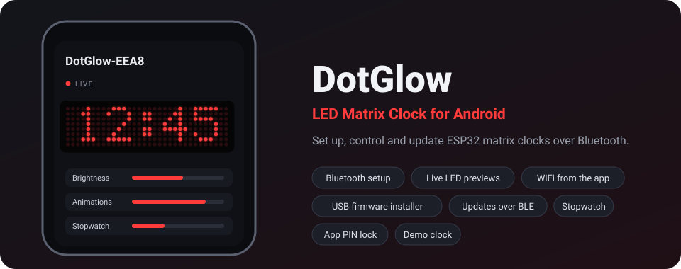</p>

<p align="center">
  <b>The Android app for DotGlow LED matrix clocks</b> (ESP32 / ESP32-S3 + MAX7219).<br>
  Pair over Bluetooth, set up WiFi, change every setting with live LED previews, update the firmware,
  and install it on brand-new boards straight from your phone.
</p>

<p align="center">
  
  
  
  
  
</p>

---

Firmware and hardware: **[DotGlow-ESP32](https://github.com/ElectroIoT/DotGlow-ESP32)**.
Package `com.electroiot.dotglow` · app name "DotGlow: LED Matrix Clock".

## Screenshots

| Find your clock | Live dashboard | Animations |
|:-:|:-:|:-:|
| 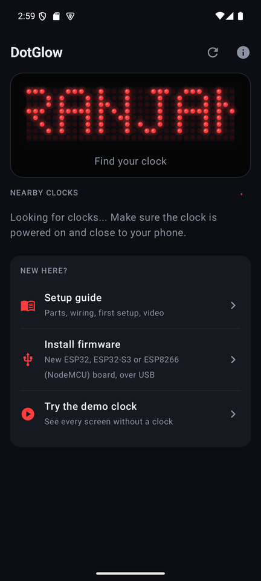 | 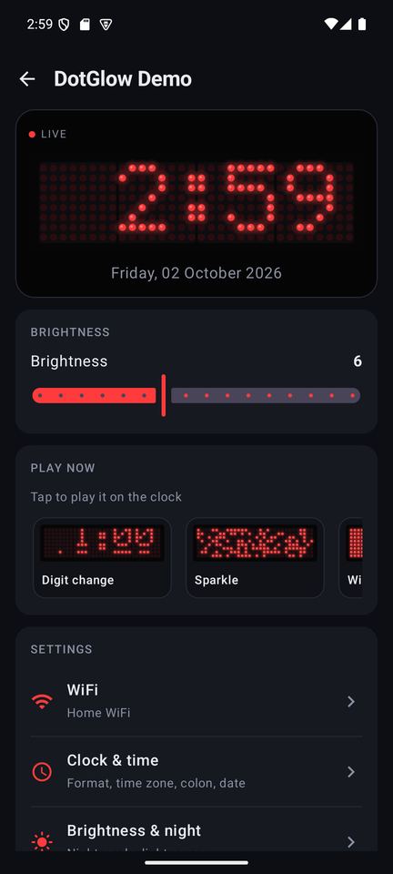 | 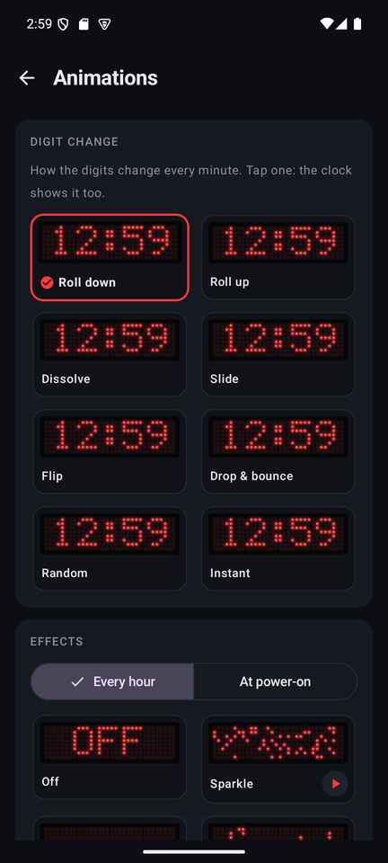 |
| **Clock & time** | **Stopwatch** | **Message** |
| 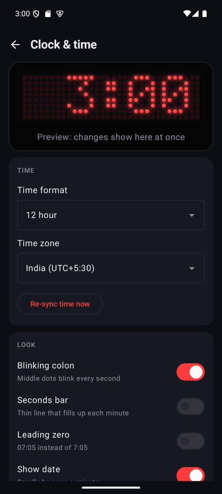 | 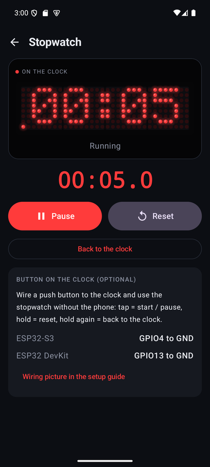 | 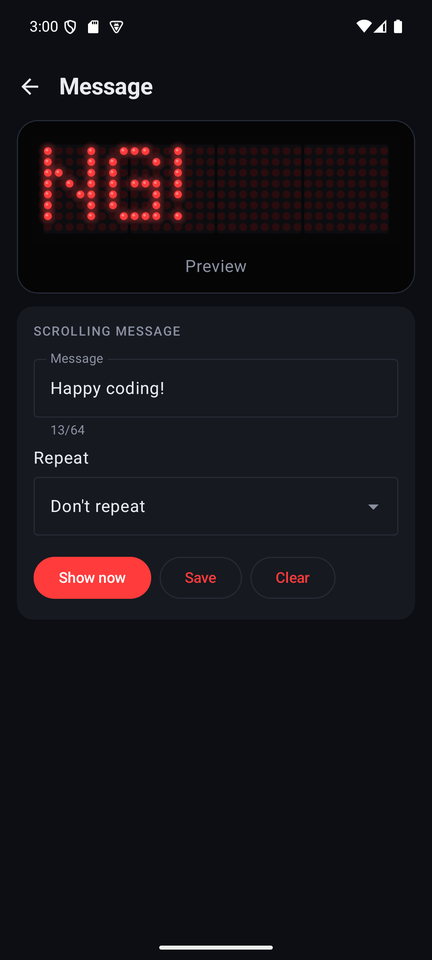 |
| **Install firmware (USB)** | **Setup guide** | **About** |
| 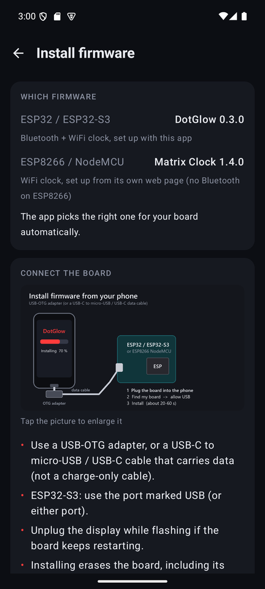 | 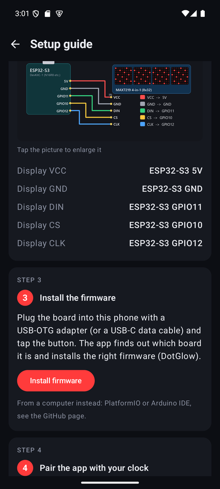 | 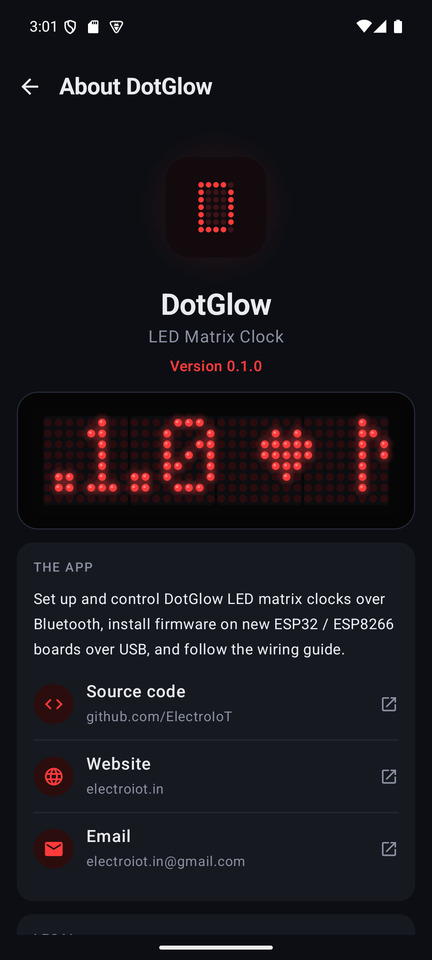 |

## Features

| | |
|---|---|
| 🔍 **Find & pair** | Lists DotGlow clocks nearby; pairs with the 6-digit PIN shown on the clock's LEDs (encrypted Bluetooth) |
| 🔴 **Live LED previews** | An on-screen MAX7219 that draws exactly what the clock shows: live clock, 6 digit styles, 5 effects, messages, stopwatch |
| 📶 **WiFi setup** | Scan and join networks through the clock, no hotspot juggling |
| ⚙️ **Every setting** | Time format and zone, colon, seconds bar, date, brightness, night mode, light sensor, modules, mirror / flip, effects, messages, special days |
| ⏱️ **Stopwatch** | Start / pause / reset on the clock, with a big readout in the app |
| 🔄 **Rotate 180°** | Display mounted upside down? One tap on the dashboard |
| ⬆️ **Updates** | Over Bluetooth (no WiFi needed, ~30 s), or ask the clock to update from GitHub |
| 🔌 **Install firmware over USB** | Plug a new ESP32 / ESP32-S3 / ESP8266 (NodeMCU) into the phone: the app detects the chip and flashes the right firmware |
| 📖 **Setup guide** | Parts, wiring pictures for 3 boards, more modules + power, light sensor, stopwatch button, video link |
| 🔒 **App lock** | Optional PIN with fingerprint unlock |
| 🎮 **Demo clock** | Every screen works without hardware |
| ℹ️ **About** | App and developer pages; links update from the web without an app update |

## How it works

<p align="center">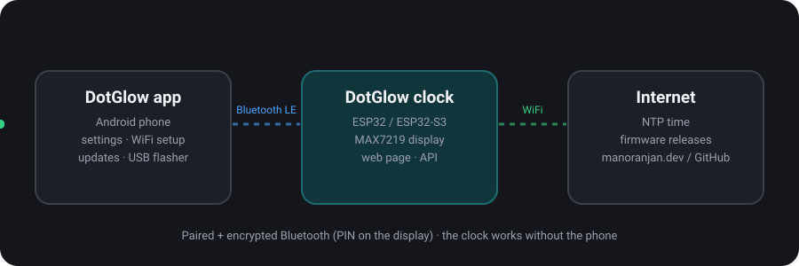</p>

## Getting started (users)

1. **Build the clock**: open the app → **Setup guide** (wiring for ESP32-S3, ESP32 DevKit, ESP8266).
   Power it from a **5 V / 1 A phone charger**: a computer USB port is too weak for the display.
2. **Install the firmware**: plug the board into the phone with a USB-OTG adapter → **Install firmware → Find my board → Install**.
3. **Pair**: power the clock, tap **DotGlow-XXXX**, type the PIN shown on the display.
4. **WiFi**: tap **Set up**, pick your network, enter the password. The clock gets the time and the app reconnects.
5. **Enjoy**: everything else is under *Settings* on the dashboard.

No clock yet? Tap **Try the demo clock**.

## Build (developers)

```bash
./gradlew assembleDebug                      # app/build/outputs/apk/debug/app-debug.apk
adb install -r app/build/outputs/apk/debug/app-debug.apk
```

Requirements: JDK 17, Android SDK 36. Stack: Kotlin 2.0.21, AGP 8.13, Compose BOM 2024.12, kotlinx.serialization,
androidx.biometric, [usb-serial-for-android](https://github.com/mik3y/usb-serial-for-android) (JitPack).

| Doc | What's in it |
|---|---|
| [docs/USER_GUIDE.md](docs/USER_GUIDE.md) | User guide: wiring, setup, every screen, buttons, troubleshooting |
| [docs/play-store/](docs/play-store/listing.md) | Play Store listing text and graphics |
| [docs/ARCHITECTURE.md](docs/ARCHITECTURE.md) | Packages, BLE layer, view models, matrix renderer, USB flasher, remote JSON files |
| [docs/DEVELOPMENT.md](docs/DEVELOPMENT.md) | Build, testing on phone / emulator, the PC flasher test, adb tips |
| [docs/RELEASE.md](docs/RELEASE.md) | Versioning, signing, Play Store checklist |
| [CHANGELOG.md](CHANGELOG.md) | What changed |
| [CLAUDE.md](CLAUDE.md) | Quick brief for AI coding assistants |

## Permissions

| Permission | Why |
|---|---|
| Bluetooth scan / connect | Find and talk to clocks (scan is marked *never for location*) |
| Location (Android 8-11 only) | Required by Android for Bluetooth scanning on those versions |
| Internet | Firmware downloads, setup-guide and About links |
| USB host (optional) | Installing firmware on a board plugged into the phone |
| Biometric | Optional fingerprint unlock of the app lock |

[Privacy policy](https://mtpcode.com/legal/dotglow/privacy.html) · [Terms of use](https://mtpcode.com/legal/dotglow/terms.html)

## Credits

[usb-serial-for-android](https://github.com/mik3y/usb-serial-for-android) (MIT) · Jetpack Compose / AndroidX (Apache-2.0) ·
the flasher speaks Espressif's ROM bootloader protocol (as documented for esptool), written from scratch in Kotlin.

## License

MIT, see [LICENSE](LICENSE). Made with care in India by [Manoranjan](https://manoranjan.dev) · [ElectroIoT](https://electroiot.in).

### Name and logo

The code is MIT licensed, but the **DotGlow** name, logo and app icon are not covered by the licence.
Forks and rebuilt apps are welcome; please publish them under your own name, icon and package
(not `com.electroiot.dotglow`), so users can tell them apart from the official app.
